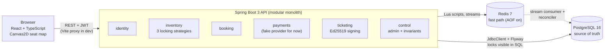

# Stampede

[](https://github.com/mannsvijay/stampede/actions/workflows/ci.yml)

**A ticketing platform built for contention: thousands of buyers racing for the same seats.**

Stampede is built for the worst five minutes in ticketing: a sold-out show goes on sale and far more people press "buy" than there are seats. Most booking systems are designed for one user and one seat. Stampede is designed from the first line of code around **contention, failure and fairness**, and every correctness claim is backed by a test you can run.

> **Status:** in active development. Milestones M0–M1 are complete and M2 (contention) is well under way: all three locking strategies, per-event strategy switching, the concurrency harness and the first k6 scenario are done. Benchmark tables, the checkout saga, the waiting room and realtime updates are next (see [Roadmap](#roadmap)).

---

## Table of contents

- [Highlights](#highlights)
- [How it works](#how-it-works)
  - [Architecture](#architecture)
  - [Pluggable inventory strategies](#pluggable-inventory-strategies)
  - [Correctness guarantees](#correctness-guarantees)
- [Results so far](#results-so-far)
- [Tech stack](#tech-stack)
- [API](#api)
- [Getting started](#getting-started)
- [Testing](#testing)
- [Load tests (k6)](#load-tests-k6)
- [Repository layout](#repository-layout)
- [Documentation](#documentation)
- [Roadmap](#roadmap)
- [Author](#author)

---

## Highlights

- **Three interchangeable locking strategies** behind one `InventoryStrategy` interface: pessimistic row locks, optimistic versioning and Redis-first Lua scripts. An admin can switch the strategy per event.
- **Zero double-sold seats**, proven by a concurrency harness that races threads for the same seats for **1,000 rounds per scenario, for every strategy**, and by k6 load runs checked against the database.
- **All-or-nothing multi-seat holds** with a server-side **per-user ticket cap**, enforced under concurrency in every strategy (including inside Lua).
- **18 invariant rules** (SQL + Redis) that run **after every integration test** and on a schedule while the app is running.
- **A unique partial index** on `order_items(event_id, seat_id) WHERE active` as the last line of defence: even buggy application code cannot sell a seat twice.
- **Ed25519-signed tickets** with QR codes that a scanner can verify offline using only the public key.
- **Spring Modulith** modular monolith with enforced module boundaries, and **570+ automated tests** (JUnit, jqwik property tests, Testcontainers, Vitest, Playwright).
- **Everything runs with one command** (`docker compose up`), and CI runs the backend tests, frontend checks and a compose smoke test on every push.

---

## How it works

### Architecture

Stampede is a **modular monolith**: one Spring Boot codebase with strictly enforced module boundaries (Spring Modulith verifies them in a test). Modules talk to each other only through each module's public API package or through events. PostgreSQL is the source of truth; Redis is the fast path and is **never trusted alone**.



| Module | Responsibility | State |
|---|---|---|
| `identity` | Registration, login, short-lived JWT access tokens, rotating hashed refresh tokens | Built |
| `inventory` | Venues, events, seat state machine, the three locking strategies, holds and the expiry sweeper, seat map | Built |
| `booking` | Orders from holds, checkout in saga-shaped steps | Built (synchronous checkout) |
| `payments` | Payment provider adapter | Fake provider; mock provider with chaos planned |
| `ticketing` | Ticket issuing, Ed25519 signing, QR payload, wallet | Built |
| `control` | Admin APIs (strategy switch, invariants), invariant checker and monitor | Built |
| `waitingroom`, `realtime` | Virtual queue, admission tokens, WebSocket seat updates | Planned |
| `shared` | Error codes, problem+json, security, Postgres UUID ordering | Built |

**Design rules the code follows**

- Data access is Spring JDBC (`JdbcClient`) + Flyway. **No JPA/Hibernate**, so every lock is visible in the SQL.
- Money is stored as `long` paise. Timestamps are UTC (`Instant`, `timestamptz`).
- Errors use **RFC 7807 problem+json** with stable error codes that clients branch on.
- Every seat transition goes through a state-machine guard; invalid transitions are rejected.

```
              hold (atomic, all-or-nothing)
 AVAILABLE ───────────────────────────────▶ HELD
     ▲                                       │  │
     └──── expire / release / checkout fail ─┘  │ payment confirmed
                                                ▼
                                              SOLD
```

### Pluggable inventory strategies

Each event uses one strategy, chosen by an admin (`POST /admin/events/{id}/strategy`) while nothing is live on the event. All three give the same guarantees; they differ in how they get there and how they perform.

| Strategy | How it works |
|---|---|
| **PESSIMISTIC** | `SELECT … FOR NO KEY UPDATE` on the requested seat rows inside one transaction, always in one global lock order (Postgres UUID order) so concurrent holds cannot deadlock. |
| **OPTIMISTIC** | A version column per event seat. `UPDATE … WHERE status = 'AVAILABLE' AND version = ?`, with bounded retries and jitter; returns `SEAT_CONTENDED` when retries run out. |
| **REDIS_FIRST** | Lua scripts atomically check and set hold keys for all requested seats with a TTL, and enforce the per-user cap inside the script. Holds are persisted to Postgres through a Redis stream; a reconciler and an invariant rule (I10) keep Redis and Postgres consistent. Redis runs with an fsynced append-only file and `noeviction`. |

Holds last five minutes. A sweeper over Postgres releases expired holds, and an invariant (I9) flags a stuck sweeper.

### Correctness guarantees

Correctness is enforced at four layers, so a mistake in one layer is caught by the next:

1. **Strategy code**: all-or-nothing holds, per-user caps and a fixed lock order.
2. **Database constraints**: CHECK constraints, and the unique partial index that makes a seat in two active orders impossible.
3. **Invariant checker**: 18 rules run per event in one read-only `REPEATABLE READ` snapshot:

   | Group | Rules | Examples |
   |---|---|---|
   | Holds | I1–I3, I8, I9 | a seat in two active holds; per-user allowance out of sync; a hold stuck past expiry |
   | Redis | I10 | Redis hold state disagrees with Postgres |
   | Orders | O1–O7 | a seat in two active orders; a sold seat without a paid order |
   | Capacity / venue | C1, V1 | sold seats exceed capacity; an event seat outside the event's venue |
   | Tickets | T1–T3 | a paid order without tickets |

   A test listener runs every rule **strictly after every Spring test** and fails the test on any violation. While the app runs, `InvariantMonitor` checks live events every 30 seconds and exposes the count as a metric. `GET /admin/invariants` gives an on-demand verdict.
4. **Concurrency harness**: N threads race for the same seats; exactly one may win. Six scenarios, each run against every strategy. CI runs 100 rounds per scenario; a manual GitHub workflow runs the full **1,000-round proof** in four parallel jobs. Any failing round can be replayed from its seed.

---

## Results so far

| Check | Result |
|---|---|
| Concurrency proof, 1,000 rounds per scenario, all strategies (manual workflow) | All four job groups green (last full run was before the deadlock fix below; CI's 100-round runs cover the fix) |
| k6 `seat-collision`: 200 buyers for 100 hot seats, each strategy | Exactly 100 sold per strategy; database count equals k6's count; strict invariant verdict: 0 violations |
| Full backend suite | Green (Testcontainers Postgres + Redis) |

**A bug this process found:** the first `seat-collision` run with the pessimistic strategy hit a PostgreSQL deadlock (`40P01`). A hold took `FOR UPDATE` on seats while ticket issuing inserted tickets whose foreign-key checks take `FOR KEY SHARE` on the same seats, in a different order. The fix moved seat locks to `FOR NO KEY UPDATE` (seat writes never change key columns) and made the ticket issuer lock seats in Postgres UUID order. Eleven tests were written first; ten failed on the old code (the eleventh was a control). After the fix, repeated `seat-collision` runs passed with no deadlock in the logs. Details: `docs/SESSION_LOG.md` and decision D-015.

Throughput and latency comparisons between the strategies (p50/p95/p99, conflict rate, database CPU) will be published in [`benchmarks/README.md`](benchmarks/README.md) once milestone M2.6 is done.

---

## Tech stack

| Area | Technology |
|---|---|
| Backend | Java 21, Spring Boot 3.5, Spring Modulith, Spring Security (OAuth2 resource server, JWT), Spring JDBC (`JdbcClient`), Flyway, springdoc-openapi |
| Data | PostgreSQL 16, Redis 7 (Lua scripts, streams, AOF persistence) |
| Frontend | React 19, TypeScript 5.9 (strict), Vite 8, React Router, TanStack Query, `openapi-fetch` with types generated from the OpenAPI spec, Canvas2D seat map, QR codes |
| Testing | JUnit 5, jqwik (property tests), Testcontainers, Vitest + MSW, Playwright, k6 |
| Infra | Docker Compose (Postgres, Redis, Mailpit, backend), GitHub Actions (pinned actions, actionlint) |

---

## API

The full contract is committed as [`docs/openapi.json`](docs/openapi.json). A test fails if the code and the committed spec drift apart, and the frontend client is generated from it.

| Method | Path | Purpose |
|---|---|---|
| `POST` | `/auth/register` | Create an account |
| `POST` | `/auth/login` | Log in; returns an access token and sets the refresh cookie |
| `POST` | `/auth/refresh` | Rotate the refresh token, get a new access token |
| `POST` | `/auth/logout` | End the session |
| `GET` | `/events` | List events |
| `GET` | `/events/{id}` | One event |
| `GET` | `/events/{id}/layout` | Static seat layout (cacheable) |
| `GET` | `/events/{id}/seatmap` | Which seats are free now, as a compact bitset (2,014 seats = 252 bytes) |
| `POST` | `/events/{id}/holds` | Hold one or more seats (all-or-nothing) |
| `DELETE` | `/holds/{id}` | Release a hold |
| `POST` | `/orders` | Buy the seats of a hold |
| `GET` | `/orders/{id}` | Order status |
| `GET` | `/me/tickets` | The current user's tickets |
| `GET` | `/tickets/keys` | Public keys for verifying ticket signatures offline |
| `POST` | `/admin/events/{id}/strategy` | Switch an event's inventory strategy (admin) |
| `GET` | `/admin/invariants` | Run an event's invariant checks now (admin) |

Errors are `application/problem+json` with a stable `code` (for example `SALE_NOT_OPEN`, `SEAT_CONTENDED`, `HOLD_EXPIRED`, `STRATEGY_SWITCH_REFUSED`).

---

## Getting started

### Prerequisites

- Docker (Docker Desktop on Windows/macOS), running
- JDK 21 (only to run the backend or tests outside Docker)
- Node.js at the version in [`frontend/.nvmrc`](frontend/.nvmrc) (Node 26)

The commands below are for bash (Linux, macOS, Git Bash). **PowerShell versions** of every command are in [`docs/DEVELOPING.md`](docs/DEVELOPING.md).

### 1. Create `.env`

```bash
cp .env.example .env
```

Then edit `.env`:

1. Replace every `change-me` value (Postgres and Redis passwords).
2. Set `STAMPEDE_JWT_SECRET` to a new random key: `openssl rand -base64 32`
3. Set `STAMPEDE_TICKET_SIGNING_KEY` to a **different** random key (the Ed25519 private key that signs tickets): `openssl rand -base64 32`. The backend refuses to start without a valid one. Keep it once set: tickets signed with an old key stop verifying.
4. Optional: `STAMPEDE_ADMIN_EMAIL` and `STAMPEDE_ADMIN_PASSWORD` (12+ characters) to create the first admin with the `bootstrap-admin` profile.

`.env` is git-ignored. Never commit it.

### 2. Start the stack

```bash
docker compose up -d --build --wait   # Postgres, Redis, Mailpit and the backend, demo data seeded
docker compose ps                     # all four should be healthy
curl http://localhost:8080/events     # the seeded demo event
```

The first build takes several minutes while Gradle downloads dependencies. All ports are bound to `127.0.0.1` only. Mailpit (a local test inbox for later email features) is at http://localhost:8025.

### 3. Start the frontend

```bash
cd frontend
npm ci --ignore-scripts
npm run dev        # http://localhost:5173, proxies the API to :8080
```

### Try a purchase

The demo event's sale opens in the future by default, and holds before the drop return `409 SALE_NOT_OPEN`. To open the demo sale now, set this in `.env` and restart the backend:

```bash
STAMPEDE_COMPOSE_PROFILES=seed,demo-open-sale
```
```bash
docker compose up -d --wait backend
```

Then register in the app, pick seats on the seat map, hold them, check out, and see the ticket's QR code in your wallet.

### Useful commands

| Task | Command |
|---|---|
| Follow backend logs | `docker compose logs -f backend` |
| Stop (keep data) | `docker compose down` |
| Reset all data | `docker compose down -v` (deletes the Postgres and Redis volumes) |
| Run the backend on the host instead | `docker compose stop backend`, then `cd backend && ./gradlew bootRun --args='--spring.profiles.active=seed,demo-reschedule'` |

**Spring profiles** (comma-separated):

| Profile | What it does |
|---|---|
| `seed` | Load the demo venue (2,014 seats) and event; safe to repeat |
| `demo-reschedule` | Move the demo drop into the future |
| `demo-open-sale` | Dev only: put the demo drop one minute in the past so its seats can be held now |
| `openapi` | Serve the generated spec at `/v3/api-docs` |
| `bootstrap-admin` | Create the first admin from `STAMPEDE_ADMIN_*` |

---

## Testing

### Backend

Tests need Docker running: they start one Postgres and one Redis container for the whole run (Testcontainers), and each Spring context gets its own database.

```bash
cd backend
./gradlew test --rerun                          # everything (--rerun avoids "UP-TO-DATE" no-op runs)
./gradlew test --rerun --tests "AuthFlowTest"   # one class
```

### Concurrency harness

`StrategyConcurrencyTest` (four scenarios) and `HoldCapConcurrencyTest` (two cap scenarios) run once per strategy; tests show up as `singleSeat[PESSIMISTIC]` and so on. CI runs 100 rounds per scenario.

```bash
# the full 1,000-round proof for one strategy
./gradlew test --rerun --tests StrategyConcurrencyTest --tests HoldCapConcurrencyTest \
  -Dstampede.harness.strategies=PESSIMISTIC -Dstampede.harness.rounds=1000

# replay one failing round from the seed in its report
./gradlew test --rerun --tests "StrategyConcurrencyTest.singleSeat" \
  -Dstampede.harness.strategies=PESSIMISTIC -Dstampede.harness.seed=<seed> -Dstampede.harness.rounds=1
```

Reports land in `backend/build/reports/concurrency/`. The complete proof for all strategies runs as the manual GitHub workflow [`concurrency-proof.yml`](.github/workflows/concurrency-proof.yml) (Actions tab, "Run workflow").

### Frontend

```bash
cd frontend
npm run typecheck
npm run lint
npm test             # Vitest + MSW
npm run check:api    # fails if the generated API types are out of date
npm run build
npm run e2e          # Playwright: buys a real seat against the local stack (needs demo-open-sale)
```

### Continuous integration

[`ci.yml`](.github/workflows/ci.yml) runs on every push to `main` and on pull requests:

- **Backend:** the full test suite with Testcontainers.
- **Frontend:** typecheck, lint, tests, API drift check, build and `npm audit`.
- **Compose smoke:** builds the backend image, starts the whole stack, checks `GET /events`, that the container runs as non-root, and that the image contains no `.env`.

---

## Load tests (k6)

`scripts/k6.sh` runs a k6 scenario in Docker against the running stack. Each run creates a fresh warm-up event and benchmark event, switches the benchmark event to the chosen strategy, runs the scenario, then checks that the database sold exactly the seats k6 counted and that the strict invariant verdict is clean.

```bash
docker compose up -d --build --wait
./scripts/k6.sh smoke
./scripts/k6.sh seat-collision --strategy REDIS_FIRST
```

Options: `--strategy PESSIMISTIC|OPTIMISTIC|REDIS_FIRST`, `--vus N`, `--hot-seats N`, `--warmup SECONDS`, `--lead SECONDS`, `--target compose|host`. Results (k6 summary, Postgres connection samples, `docker stats`) are written to `benchmarks/runs/<UTC time>-<scenario>-<strategy>/`. The script exits with 0 only if the k6 thresholds pass and the database check agrees.

---

## Repository layout

```
backend/                     Spring Boot app (Gradle, Java 21)
  src/main/java/com/stampede/
    identity/ inventory/ booking/ payments/ ticketing/ control/ waitingroom/ realtime/ shared/
  src/main/resources/
    db/migration/            Flyway migrations
    redis/                   Lua scripts (hold, release, sold, load, state, ...)
    seed/                    demo venue and event
frontend/                    React + TypeScript + Vite
  src/api/                   generated types, typed client, auth and refresh logic
  src/seatmap/               seat map decoding, geometry, Canvas2D drawing
  src/pages/                 events board, event, login/register, seats + checkout, wallet
  e2e/                       Playwright purchase test
scripts/k6.sh, scripts/k6/   load-test runner and scenarios
benchmarks/                  benchmark write-up (results land here)
docs/                        PRD, plan, decisions, developer guide, OpenAPI spec
.github/workflows/           ci.yml, concurrency-proof.yml
docker-compose.yml           Postgres, Redis, Mailpit, backend
```

---

## Documentation

| Document | What's in it |
|---|---|
| [`docs/PRD.md`](docs/PRD.md) | Full product spec: goals, journeys, architecture, data model, API contract, testing strategy |
| [`docs/PLAN.md`](docs/PLAN.md) | Milestone plan and progress |
| [`docs/DECISIONS.md`](docs/DECISIONS.md) | 24 design decisions with the options considered and trade-offs |
| [`docs/DEVELOPING.md`](docs/DEVELOPING.md) | Developer guide (Windows PowerShell) |
| [`docs/SESSION_LOG.md`](docs/SESSION_LOG.md) | Work log with verification evidence for each task |
| [`docs/openapi.json`](docs/openapi.json) | The API contract |
| [`docs/venue-format.md`](docs/venue-format.md), [`docs/ticket-format.md`](docs/ticket-format.md) | Venue file and ticket payload formats |

---

## Roadmap

- [x] **M0 Skeleton:** repo, Docker Compose, schema, auth with refresh rotation, seeded 2,014-seat venue, CI
- [x] **M1 Core booking:** seat state machine, pessimistic strategy, holds with expiry, orders, signed tickets, invariant checker, Canvas2D seat map
- [ ] **M2 Contention**
  - [x] Optimistic and Redis-first strategies
  - [x] Per-event strategy switch; harness parameterised over all three strategies
  - [x] k6 harness and `seat-collision` scenario; deadlock found and fixed
  - [ ] `mixed-realistic` scenario, benchmark runs and published strategy comparison
- [ ] **M3 Checkout resilience:** idempotency keys, transactional outbox, mock payment provider with chaos, persisted saga with compensation, signed webhooks
- [ ] **M4 Fairness:** virtual waiting room (Redis sorted set), signed admission tokens, proof-of-work, token-bucket rate limits, adaptive (AIMD) admission, bot-swarm tests
- [ ] **M5 Realtime + frontend:** WebSocket seat-map diffs, hold timer, waiting room screen, operator control room
- [ ] **M6 Resilience:** multiple API instances behind Nginx, chaos scripts, Prometheus + Grafana, soak test
- [ ] **M7 Ship:** deployment, architecture write-up, results, demo video

**Targets** (to be measured and published honestly, whatever the results): 0 double-sold seats, 0 paid orders without tickets, hold p95 < 50 ms on a single machine, ≥ 2,000 hold attempts/s, waiting-room fairness (Kendall tau) ≥ 0.95, bots winning < 5% of seats.

---

## Author

**Manan Vijay**: [GitHub](https://github.com/mannsvijay) · [LinkedIn](https://www.linkedin.com/in/mannsvijay/) · [mananvijay13@gmail.com](mailto:mananvijay13@gmail.com)
